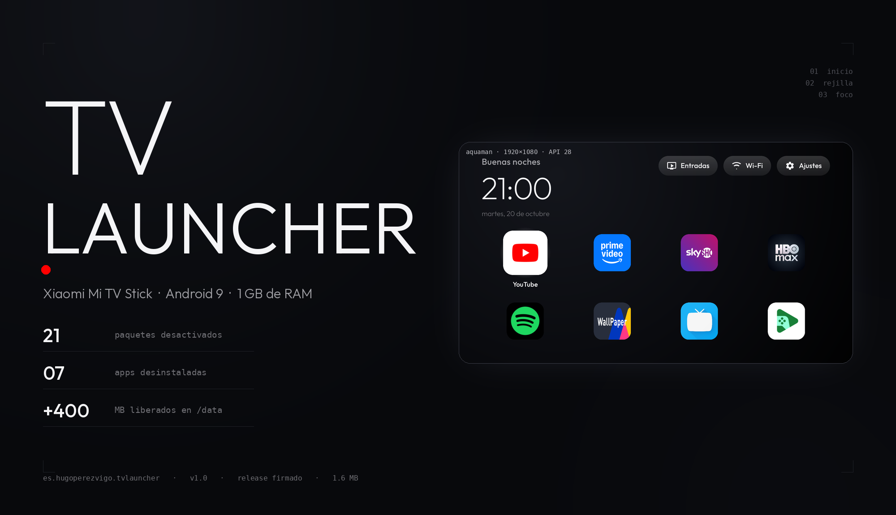
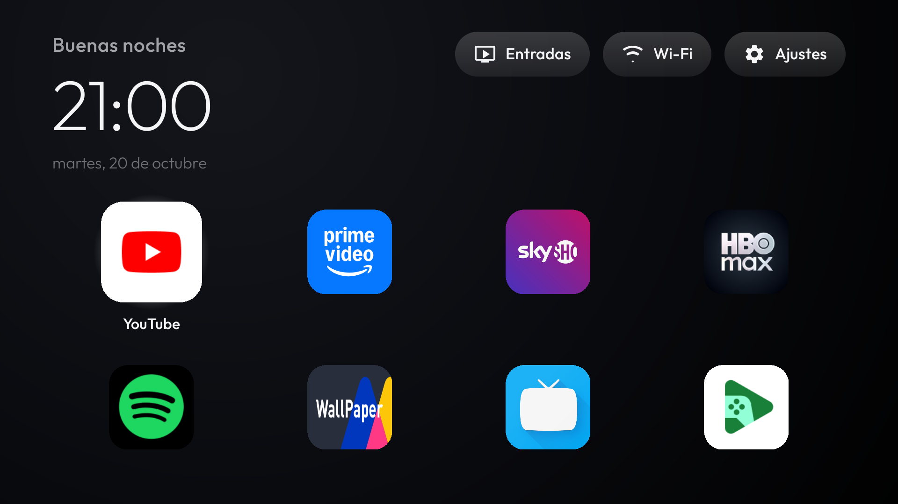
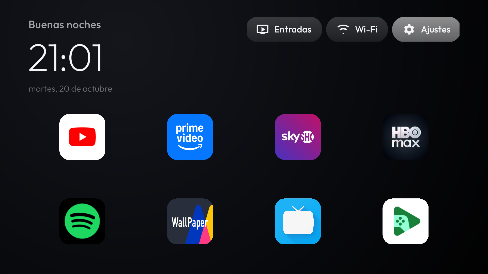
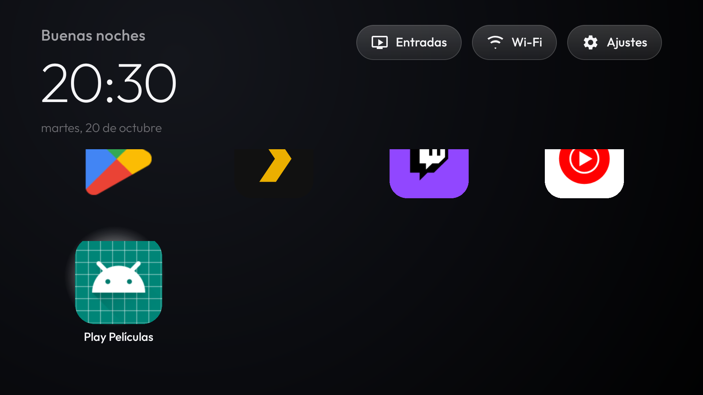
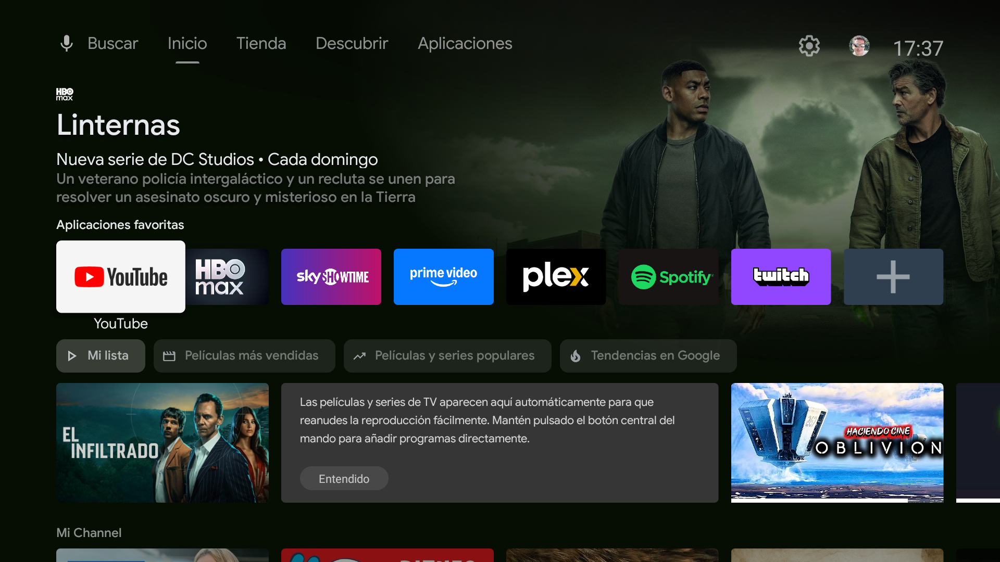

<p align="center">
  
</p>

<p align="center">
  <b>Un launcher de TV propio, en Java, para el Xiaomi Mi TV Stick.</b><br>
  Sin fila «Patrocinado», sin «Mi Channel», sin recomendaciones.
</p>

<p align="center">
  <a href="dist/tvlauncher-1.0-release.apk"></a>
  
  
  
</p>

---

## Qué es esto

Un trabajo completo sobre un **Xiaomi Mi TV Stick** (`MiTV-AESP0`, Android 9,
Google TV, 1 GB de RAM):

1. **Debloat**: 21 paquetes desactivados y 7 apps desinstaladas. +400 MB de
   disco, +50 MB de RAM, sin rastro del telemetría de Xiaomi ni del Asistente
   de Google.
2. **Un launcher propio** en Java (AndroidX RecyclerView) que sustituye al de
   Google TV, con navegación determinista por D-pad, un cristal que salta de
   tesela en tesela y tipografía Outfit.
3. **El arreglo de por qué el mando no despertaba el stick** (y de por qué la
   causa era el propio debloat).

Todo es **reversible**: no se toca la partición de firmware ni el bootloader.

> 📄 **[Informe completo → `docs/INFORME.md`](docs/INFORME.md)** — qué se
> desactivó y por qué, qué se probó y falló, y lo aprendido del dispositivo.

## Descargar

| | |
|---|---|
| [`tvlauncher-1.0-release.apk`](dist/tvlauncher-1.0-release.apk) | 1,6 MB · release firmado · `es.hugoperezvigo.tvlauncher` |
| [`sha256`](dist/tvlauncher-1.0-release.apk.sha256) | `ac4de70b…c7f` |

```bash
adb install -r tvlauncher-1.0-release.apk
adb shell cmd package set-home-activity es.hugoperezvigo.tvlauncher/.LauncherActivity
adb shell pm disable-user --user 0 com.google.android.tvlauncher
adb reboot
```

El paso 3 **no es opcional**: mientras el launcher de Google TV siga
habilitado, el sistema lo relanza y se pone delante del nuestro. Está
explicado en el [informe](docs/INFORME.md#6-por-qu%C3%A9-hay-que-desactivar-el-launcher-de-google-tv).

<details>
<summary>Compilar desde el código</summary>

```bash
cd launcher
./build.sh assembleRelease      # necesita el SDK de Android y JDK 21
./build.sh testDebugUnitTest    # 32 tests
```

El build usa el toolchain de Windows (SDK en `C:\Users\Hugop\AppData\Local\Android\Sdk`,
JDK 21 de Adoptium) porque es donde está instalado; `build.bat` hace lo mismo
desde Windows.

La firma de release busca el keystore en `~/.config/suop/` (o en
`C:\Users\<usuario>\.config\suop\`, o donde apunte `TVLAUNCHER_SIGNING_DIR`).
**El keystore y las contraseñas no están en el repo**: sin ellos, el build de
release sale sin firmar y el de debug funciona igual.
</details>

## El launcher

| | |
|---|---|
|  |  |
| La pantalla de inicio: reloj, menús y rejilla a todo el ancho. | El foco de los menús se distingue por el relleno, sin reborde. |

- Fondo negro con un halo radial muy suave, reloj grande y fino, fecha y
  saludo, todo en **Outfit** (OFL).
- Menús redondeados con icono: **Entradas**, **Wi-Fi** y **Ajustes**.
- Rejilla de **4 columnas a todo el ancho** con todas las apps de TV.
- Un único **cristal** que salta de tesela en tesela; la enfocada crece y
  muestra su nombre debajo.
- **Navegación determinista**: Up/Down mueven exactamente una fila, Up desde
  la primera fila sube a la barra, los extremos de la barra no se caen a las
  teselas y se recuerda la última tesela enfocada.

El orden de las apps se configura en
[`config.xml`](launcher/app/src/main/res/values/config.xml): las que Uses
arriba, las que no, al final.



## El debloat

| | Antes | Después |
|---|---|---|
| Pantalla de inicio | Google TV | launcher propio |
| Disco libre en `/data` | 1,8 GB | **2,2 GB** |
| RAM disponible | ~242 MB | **~292 MB** |
| Paquetes de terceros activos | 99 | 71 |

21 paquetes desactivados con `pm disable-user` (contenido de Xiaomi,
telemetría, recomendaciones, asistente de voz) y 7 apps desinstaladas con
`pm uninstall --user 0` (streaming que no usabas, ~109 MB).

Ni una sola cosa del sistema se borró: `pm disable-user` no borra nada, se
revierte con `pm enable`.


*El launcher de Google TV antes: «Patrocinado», «Mi Channel» y recomendaciones.*

## Revertir

```bash
./tools/restore.sh                      # debloat: reactiva y reinstala
cd launcher && ./tools/uninstall-launcher.sh   # devuelve el launcher de fábrica
```

Detalle de qué se puede y qué no se puede revertir (y por qué el
`pm uninstall` borra el APK de forma asíncrona) en el
[informe](docs/INFORME.md#32-apps-desinstaladas-7).

## Repositorio

```
firestick-debloat/
├── docs/INFORME.md      informe completo
├── docs/capturas/       capturas de referencia
├── dist/                APK firmado + checksum
├── launcher/            código fuente del launcher (Java, 32 tests)
├── tools/               backup, restore, disable, sanitizado, cabecera
└── backup/2026-10-20/   estado original del dispositivo
```

## Licencia

El código de este repositorio está bajo **MIT**. La tipografía
[Outfit](https://fonts.google.com/specimen/Outfit) se distribuye bajo su
licencia **SIL Open Font License 1.1** (los ficheros `.ttf` van incluidos en
`launcher/app/src/main/res/font/`).

Las capturas muestran la interfaz del launcher propia; el wallpaper y los
iconos de las apps pertenecen a sus respectivos titulares.
