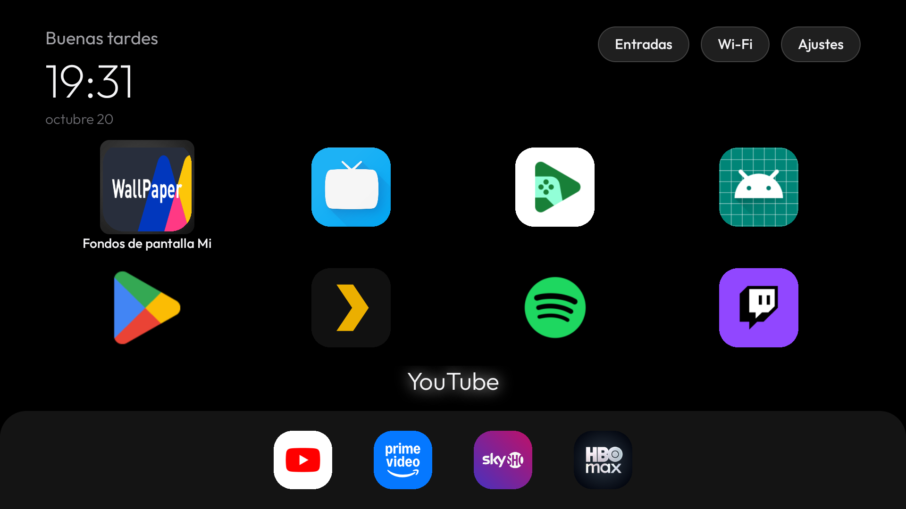
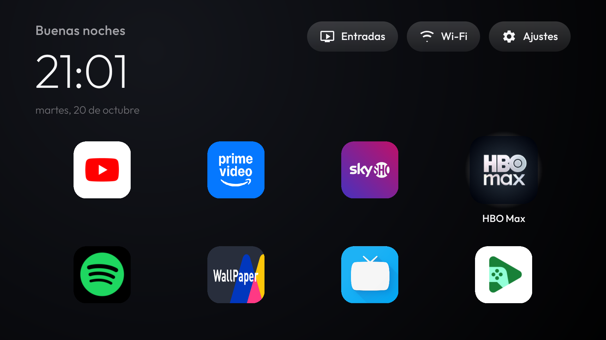

# Mi TV Stick: debloat + launcher propio

Informe completo del trabajo hecho el **20 de octubre de 2026** sobre el
**Xiaomi Mi TV Stick (MiTV-AESP0)**, codename `aquaman`, Android 9 / API 28,
**Google TV**, firmware `PI.2055` (build 22.9.6.2055), 1 GB de RAM, IP
`192.168.3.124`.

Todo es **reversible**. Ni un solo cambio en la partición de firmware, ni en el
bootloader, ni desinstalación de nada del sistema.

---

## 1. Resumen del resultado

| | Antes | Después |
|---|---|---|
| Pantalla de inicio | Google TV (con "Patrocinado" y "Mi Channel") | **Launcher propio** (`es.hugoperezvigo.tvlauncher`) |
| Disco libre en `/data` | 1,8 GB (60% ocupado) | **2,2 GB (52% ocupado)** |
| RAM disponible | ~242 MB | **~292 MB** |
| Paquetes de terceros activos | 99 | 71 |
| Apps de usuario instaladas | 11 | 5 |
| ADB de red (puerto 5555) | abierto | **cerrado** |

Las 5 apps de usuario que quedan son las que usas: **Prime Video,
SkyShowtime, HBO Max, Spotify y Twitch** (más YouTube, que estaba en el
sistema).


*El launcher de Google TV antes del trabajo: fila "Patrocinado", "Mi Channel"
y recomendaciones.*


*El launcher propio, arrancando en frío tras reiniciar el stick.*

---

## 2. Qué hay en este repositorio

| Documento | Para qué |
|---|---|
| **Este informe** | Qué se hizo, por qué, y qué se probó y falló |
| [`GUIA-DEBLOAT.md`](GUIA-DEBLOAT.md) | Cómo aplicarlo paso a paso, a esta tele o a otra |
| [`../PROMPT.md`](../PROMPT.md) | Para que un asistente con shell lo repita solo en otra tele |
| [`PLAN.md`](PLAN.md) | El plan por lotes tal como se ejecutó |

```
firestick-debloat/
├── README.md                  ← este documento
├── PROMPT.md                  prompt para repetirlo en otra tele
├── docs/
│   ├── INFORME.md             ← informe completo
│   ├── GUIA-DEBLOAT.md        ← guía paso a paso
│   ├── PLAN.md                ← plan del debloat con los lotes y sus motivos
│   ├── canvas/                ← filosofía de la imagen de cabecera
│   └── capturas/              ← capturas de referencia
├── dist/
│   ├── tvlauncher-1.0-release.apk        ← el launcher ya compilado y firmado
│   └── tvlauncher-1.0-release.apk.sha256
├── launcher/                  ← código fuente del launcher
│   ├── README.md              ← detalles técnicos del launcher
│   ├── app/src/main/…         ← Java + recursos
│   ├── app/src/test/…         ← 32 tests unitarios
│   ├── build.sh / build.bat   ← compilación
│   └── tools/                 ← instalar, desinstalar, comprobar
├── tools/                     ← scripts del debloat
│   ├── apply-debloat.sh       ← aplica todo en lotes, con backup y verificación
│   ├── disable.sh             ← aplica una lista
│   ├── restore.sh             ← lo revierte
│   ├── disabled.list          ← la lista de debloat, comentada por categorías
│   ├── backup.sh / check.sh / shot.sh
│   ├── sanitize-for-public.sh ← limpia identificadores antes de publicar
│   └── make-hero.py           ← genera la imagen de cabecera
└── backup/2026-10-20/         ← estado original del dispositivo
    ├── packages-full.txt      ← los 99 paquetes que había
    ├── getprop.txt            ← propiedades del sistema
    └── settings-*.txt         ← todos los ajustes
```

### El APK

`dist/tvlauncher-1.0-release.apk` (1,6 MB, release firmado) ya está compilado y con su checksum
SHA-256:

```
ac4de70bb3785955a59752af74815a72b1601c435e8edbdbad8911ac61355c7f
```

Para instalarlo a mano:

```bash
adb install -r dist/tvlauncher-1.0-release.apk
adb shell cmd package set-home-activity es.hugoperezvigo.tvlauncher/.LauncherActivity
adb shell pm disable-user --user 0 com.google.android.tvlauncher
adb reboot
```

El paso 3 es **imprescindible**: mientras el launcher de Google TV esté
habilitado, el sistema lo relanza y se pone delante del nuestro (ver §6).

---

## 3. El debloat

La lista completa está en [`tools/disabled.list`](../tools/disabled.list), una
línea por paquete, comentada por categorías y con el motivo de cada uno. El
prefijo `!` marca las que se **desinstalan** en vez de desactivarse.

Para aplicarla:

```bash
./tools/apply-debloat.sh     # backup + lotes + verificación
```

La guía paso a paso, con los comandos a mano y qué hacer si algo falla, está
en [`GUIA-DEBLOAT.md`](GUIA-DEBLOAT.md).

### 3.1 Paquetes desactivados (21)

Con `pm disable-user --user 0`. **No se desinstala nada del sistema**: el APK
sigue en el disco y la operación se revierte en un segundo con `pm enable`.

**Contenido, publicidad y telemetría de Xiaomi**

| Paquete | Qué es |
|---|---|
| `com.mitv.tvhome.mitvplus` | Mi TV Plus / PatchWall (contenido preinstalado) |
| `com.mitv.tvhome.atv` | Mi TV Home |
| `com.mitv.tvhome.michannel` | Mi Channel |
| `com.xm.webcontent` | Contenido web de Xiaomi |
| `com.xiaomo.tv.milegal` | Avisos legales de Xiaomi |
| `com.miui.tv.analytics` | Telemetría de Xiaomi |
| `com.mitv.download.service` | Descargas de contenido (además crasheaba solo) |
| `com.mitv.videoplayer` | Reproductor de vídeo de Xiaomi |
| `com.mitv.milinkservice` | Mi Link (mando desde el móvil) |
| `android.autoinstalls.config.xioami.mibox3` | **Auto Install Config**: permite que Play Store autoinstale apps |
| `tv.alphonso.alphonso_eula` | EULA de Alphonso (telemetría de TV) |
| `com.xiaomi.android.tvsetup.partnercustomizer` | Asistente de configuración de Xiaomi |

**Google: recomendaciones, telemetría y asistente**

| Paquete | Qué es |
|---|---|
| `com.google.android.tvrecommendations` | Filas de recomendaciones y "Patrocinado" |
| `com.google.android.backdrop` | Fondo ambiental (ver §5, pasó factura) |
| `com.google.android.feedback` | Envío de feedback |
| `com.google.android.tv.bugreportsender` | Informes de error |
| `com.google.android.partnersetup` | Atribución a partners |
| `com.google.android.syncadapters.contacts` | Sincronización de contactos |
| `com.google.android.syncadapters.calendar` | Sincronización de calendario |
| `com.google.android.katniss` | Asistente de Google (voz) |
| `com.google.android.speech.pumpkin` | Reconocimiento de voz |

### 3.2 Apps desinstaladas (7)

Con `pm uninstall --user 0`: `com.netflix.ninja` (42 MB),
`com.disney.disneyplus` (23), `com.antena3.atresplayer.tv` (23),
`com.rt.tv` (11), `tv.accedo.mitele_xdk` (8), `dw.com.androidtv.live` (2) y
`com.overdevs.at4k`.

`com.overdevs.at4k` (app de TV española) **se autoinstaló sola** a las 17:19
durante la sesión, por el Auto Install Config de Xiaomi. Esa es la razón de
desactivar ese paquete.

**Aviso importante sobre la reversibilidad de esto**: `pm uninstall --user 0`
borra el APK de `/data/app` de forma **asíncrona**. Si se restaura el paquete
con `pm install-existing` *antes* de que ese borrado se ejecute, funciona sin
volver a descargarlo. Si se deja pasar el borrado, el paquete desaparece del
sistema y hay que reinstalarlo desde Play Store. Se comprobó con Netflix
(restaurado con `install-existing` y desinstalado otra vez) y con las otras
cinco, cuyo APK ya había desaparecido. Todas son gratuitas y están en Play
Store, así que reinstalarlas es un trámite, pero conviene saberlo.

En cambio, `pm disable-user` (los 21 paquetes del sistema) **no borra nada**.

### 3.3 Qué NO se tocó, y por qué

| Paquete | Motivo |
|---|---|
| `com.google.android.tvlauncher` | Desactivado (no borrado) para que no se relance: ver §6 |
| `com.google.android.tungsten.setupwraith` | La red Wi-Fi de la 1ª configuración es suya (`cname=com.google.android.tungsten.setupwraith`). Desactivarla **borraría esa red** y el stick se quedaría sin Wi-Fi ni ADB |
| `com.android.tv.settings` | Ajustes del sistema: entrada HDMI, pairing del mando |
| `com.google.android.gms`, `gsf`, `vending` | Play Services y Play Store |
| `com.google.android.inputmethod.latin` | Teclado en pantalla |
| `com.google.android.tts` | Accesibilidad (TalkBack) |
| `com.google.android.apps.mediashell` | Chromecast (decisión del usuario) |
| `com.xiaomi.mitv.updateservice` | Actualizaciones de firmware (decisión del usuario) |
| `com.mitv.service` | Servicio de TV de Xiaomi: permiso **HDMI_CEC** y apagado del TV |
| `com.mitv.dream` | Protector de pantalla (imprescindible, ver §5) |
| `com.droidlogic.*`, `com.android.bluetooth`, `InputDevices` | Hardware, pairing y mando |
| `com.android.shell` | Se usa para el propio ADB |

### 3.4 Lo que no se puede arreglar sin root

- **La fila "Mi Channel"** del launcher de Google TV: se comprobó que **no**
  viene de `mitv.service` ni de `com.google.android.tv` (desactivando ambos
  seguía apareciendo), y no hay ningún paquete desactivable que la sirva. Con
  el launcher propio desaparece de la pantalla, pero el servicio sigue ahí
  detrás.
- **Los procesos PERSISTENT** (`xiaomi.tvservice` y
  `com.xiaomi.android.tvsetup.partnercustomizer`): Android ignora el `disable`
  de los paquetes persistentes y `pm disable` a nivel de componente está
  bloqueado por seguridad (`SecurityException: Shell cannot change component
  state … to 2`). Sin root son inmortales. Ocupan ~50 MB de RAM entre los dos.
- **La fila "Patrocinado"** la pintaba el launcher de Google TV; con el
  launcher propio ya no aparece.

---

## 4. El launcher propio

Java, AndroidX RecyclerView, `minSdk 21`, `targetSdk 34`. 2,2 MB de APK,
32 tests unitarios. Detalles técnicos en [`launcher/README.md`](../launcher/README.md).


### Qué hace

- Fondo negro con un halo radial muy suave arriba a la izquierda, reloj
  grande y fino (76sp) con la fecha y el saludo, todo en **Outfit** (OFL).
- Menús redondeados con icono: **Entradas**, **Wi-Fi** y **Ajustes**.
- Rejilla de **4 columnas a todo el ancho** con las 13 apps de TV instaladas.
- Un único "cristal" que salta de tesela en tesela. La tesela enfocada crece
  y muestra su nombre debajo.
- Navegación determinista: Up/Down mueven exactamente una fila, Up desde la
  primera fila sube a la barra, los extremos de la barra no se caen a las
  teselas, y se recuerda la última tesela enfocada.

### Orden de las apps

Configurable en `launcher/app/src/main/res/values/config.xml`:

```xml
<string-array name="apps_first">
    <item>com.google.android.youtube.tv</item>          <!-- YouTube -->
    <item>com.amazon.amazonvideo.livingroom</item>      <!-- Prime Video -->
    <item>com.skyshowtime.skyshowtime.google</item>     <!-- SkyShowtime -->
    <item>com.wbd.stream</item>                         <!-- HBO Max -->
    <item>com.spotify.tv.android</item>                 <!-- Spotify -->
</string-array>

<string-array name="apps_last">
    <item>com.google.android.videos</item>              <!-- Play Películas -->
</string-array>
```

`apps_first` va arriba en ese orden, `apps_last` al final, el resto
alfabéticamente en medio. Los paquetes que no estén instalados se ignoran.


### Foco


El foco de los menús se distingue **solo por el relleno más claro**, sin
reborde. El de las apps, por el cristal y por el nombre debajo.



El icono crece **dentro de sus propios límites** (no escalando la vista), así
que nunca se sale de su celda ni se recorta, ni siquiera en la última
columna contra el borde de la pantalla.

### Detalles del dispositivo que condicionaron el código

- **API 28, no 31**: `LauncherActivityInfo.getActivityInfo()` es API 31, así
  que el catálogo usa `getComponentName()` y `PackageManager`.
- **`PackageManager`, no `LauncherApps`**: en Android 9 `LauncherApps` solo
  devuelve parte de las apps (dejaba fuera Amazon Video, HBO Max, Play Games
  y Videos). Con `PackageManager` se obtienen las 13.
- **Dos consultas, no una**: `LEANBACK_LAUNCHER` y `LAUNCHER` se consultan por
  separado. En un solo intent Android exige que la app declare *todas* las
  categorías, y juntos solo saldrían las que declaran las dos.
- **Sin blur ni vídeo**: el stick tiene 1 GB de RAM. El cristal es un
  degradado, no un desenfoque.

### Volver atrás

```bash
cd launcher && ./tools/uninstall-launcher.sh
```

Devuelve el HOME al launcher de Google TV, lo reactiva, desinstala el
nuestro y reinicia.

---

## 5. El mando no despertaba el stick (arreglado)

**Síntoma**: había que apagar y encender la TV aunque el stick tuviera la luz
de standby.

**Diagnóstico** (no era el hardware):

1. El mando del stick es **Bluetooth** (aparece emparejado como
   `MiTVStick`), no infrarrojo.
2. El stick se alimentaba por USB del TV (`mPlugType=2`) pero con
   `stay_on_while_plugged_in=0`: a los 15 minutos entraba en **suspensión
   profunda**, se apagaba el Bluetooth y el mando ya no podía despertarlo.
3. La causa concreta: el protector de pantalla configurado era
   `com.google.android.backdrop`, **que desactivé yo en el debloat**. Sin un
   componente de dream válido, el sistema no activa el protector y suspende
   el dispositivo en vez de eso.

**Arreglo aplicado**:

```bash
adb shell settings put secure screensaver_components com.mitv.dream/.MiDream
adb shell settings put global stay_on_while_plugged_in 7
adb shell settings put system screen_off_timeout 1800000
```

`com.mitv.dream/.MiDream` es el protector de pantalla de Xiaomi, un
`DreamService` válido. Con él, el stick entra en modo protector en vez de
suspenderse: el Bluetooth sigue vivo y el mando lo despierta.
`stay_on_while_plugged_in 7` lo mantiene despierto mientras está alimentado.

> **Aviso**: si algún día se cambia el protector de pantalla, hay que volver a
> apuntar a `com.mitv.dream/.MiDream` o el mando volverá a no despertar el
> stick.

---

## 6. Por qué hay que desactivar el launcher de Google TV

Poner `set-home-activity` **no basta**. El launcher de Google TV se relanza a
sí mismo con `launchedFromUid=0` (system_server) a través de `mitv.service`,
que corre como `uid 1000` y es PERSISTENT, así que ignora el `disable`.

Con `pm disable-user --user 0 com.google.android.tvlauncher` ya no lo relanza y
el launcher propio queda como inicio, **también tras reiniciar**. Es
reversible con `pm enable`.

Alternativas que se probaron y no sirvieron:

| Se probó | Resultado |
|---|---|
| `pm disable` (estado 2) | `SecurityException: Shell cannot change component state for com.google.android.tvlauncher/null to 2` |
| Desactivar `mitv.service` | Es PERSISTENT: el proceso sobrevive y sigue lanzando el launcher de Google |
| `cmd package set-home-activity` a secas | El HOME preferido cambia, pero el launcher de Google se relanza igualmente |

---

## 7. Cómo revertirlo todo

### El debloat

```bash
cd firestick-debloat
./tools/restore.sh
```

Reactiva los 21 paquetes desactivados y reinstala las 7 desinstaladas (las
que aún tengan el APK en disco; el script avisa del caso). La fuente de verdad
son `tools/disabled.list`: una lista por línea, comentada por categorías, con
prefijo `!` en las que se desinstalan en vez de desactivarse.

Para rehacer el backup del estado actual:

```bash
./tools/backup.sh
```

### El launcher

```bash
cd launcher && ./tools/uninstall-launcher.sh
```

### El ADB

Está **cerrado** (puerto 5555 = `Connection refused`, verificado tras
reiniciar). Para volver a conectarlo:

1. En el stick: Ajustes → Developer options → *ADB debugging* (la casilla de
   red) → activarla y aceptar el diálogo en pantalla.
2. `adb connect 192.168.3.124:5555`

---

## 8. Resumen de lo aprendido del dispositivo

Cosas que solo se descubren trabajando contra el stick real, guardadas por
si hay que repetir el trabajo en otro modelo de Xiaomi:

1. `LauncherApps` no devuelve todas las apps en Android 9 → usar
   `PackageManager`.
2. Dos categorías en un mismo intent se exigen **juntas** (AND), no
   alternativas → consultar por separado.
3. `getActivityInfo()` es API 31 → no usable en un stick con Android 9.
4. El launcher de Google TV se relanza desde `mitv.service` (uid 1000,
   PERSISTENT) → hay que desactivarlo, no solo cambiar el HOME.
5. Desactivar el protector de pantalla (`com.google.android.backdrop`) rompe
   el despertar con el mando por Bluetooth.
6. `pm disable-user` no borra nada; `pm uninstall --user 0` borra el APK, y
   el borrado es asíncrono (condición de carrera al restaurar).
7. `pm disable` a estado 2 está bloqueado por seguridad en paquetes
   persistentes; `pm disable-user` (estado 3) sí funciona.
8. `adb shell` hereda el `stdin` del bucle `while read` y se come el resto
   de la lista → usar `< /dev/null` en cada llamada.
9. El servicio de TV de Xiaomi (`mitv.service`) tiene permiso **HDMI_CEC** y
   gestiona el apagado del TV: no se debe tocar.

---

## 9. Notas de publicación

**Paquete**: `es.hugoperezvigo.tvlauncher`. La primera versión del launcher
usaba `com.suop.tvlauncher` y se renombró: nada de lo que hay aquí tiene que
ver con SUOP, es un proyecto personal.

**Firma**: el APK de `dist/` es un build de **release firmado** con una clave
RSA de 4096 bits generada para este repositorio.

```
CN=TV Launcher, OU=Personal, O=Hugo Perez Vigo, C=ES
SHA-256: 319f40b9249bc678d9a31bac7693500d90858d32895b83181f3e2c4045eff2f1
```

El keystore **no** está en el repositorio (está en `~/.config/suop/`, con
permisos `600`). El `build.gradle` lo busca ahí, o en
`C:\Users\<usuario>\.config\suop\`, o donde apunte la variable de entorno
`TVLAUNCHER_SIGNING_DIR`. Sin él, el build de release sale sin firmar.

**Privacidad**: antes de publicar se sanearon los identificadores del
dispositivo (MAC, `android_id` y número de serie) de los ficheros de backup,
con `tools/sanitize-for-public.sh`, que es reproducible y auditable.
